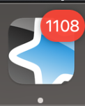

# Anki Dock Badge

An Anki add-on that displays your total due card count (New + Learning + Review) as a numeric badge on the Anki Dock icon.



## Platforms Supported
| Platform | Support Level | Implementation Notes |
| :--- | :--- | :--- |
| **macOS** | Full Support | Native red badge on the Dock. Set through `UNUserNotificationCenter` (macOS 13+), so the count stays on the icon after Anki quits and keeps updating while Anki is closed (learning cards coming due, day rollover), checked hourly. Falls back to Qt's `setBadgeNumber()` on older macOS. |
| **Windows 10 / 11** | Full Support | Native taskbar overlay icon using the Windows `ITaskbarList3` API. |
| **Linux** | Conditional Support | Depends on the desktop environment; X11 and Wayland supported and requires D-Bus launcher badge support (e.g., GNOME, KDE Plasma). Fails silently on minimalist window managers like i3 or openbox. |

## Features

- Shows total cards due across all decks as a Dock badge
- Clears the badge automatically when no cards are due
- Updates after answering a card, finishing a sync and any changes to the queue
- Compatible with Anki 24+ (Qt6.5+)
- Uses Qt 6's QGuiApplication::setBadgeNumber() (Qt 6.5+) on Windows and Linux
- macOS: the badge persists after Anki quits and is kept up to date while Anki is closed, via badge-only notifications scheduled at quit for the next 48 hours (hourly steps plus day rollovers)

## Limitations

- macOS: updates while Anki is closed run for 48 hours after you quit, in hourly steps; after that, or after a crash or force-quit, the badge stays at the last number until Anki is opened again. Studying on another device is not reflected until Anki syncs. macOS asks once to allow notifications (badge only) for Anki; if you decline, the add-on uses Qt's badge, which disappears on quit.
- Windows/Linux: the badge disappears when Anki is closed (badges are owned by the running process)

## Installation
### Via AnkiWeb

Search for **Dock Badge** on [AnkiWeb](https://ankiweb.net/shared/addons).

### Manual

1. Download or clone this repository
2. Copy the `ankibadge` folder to your Anki add-ons directory:
   ```
   cp -r ankibadge ~/Library/Application\ Support/Anki2/addons21/ankibadge
   ```
3. Restart Anki


## Requirements

- Anki 24.x or later

## Disclaimer

> This add-on was written with the assistance of Claude (Anthropic's AI assistant). It has been tested on macOS and works as described, but is provided as-is with no warranty. Use at your own risk.

## License

MIT
